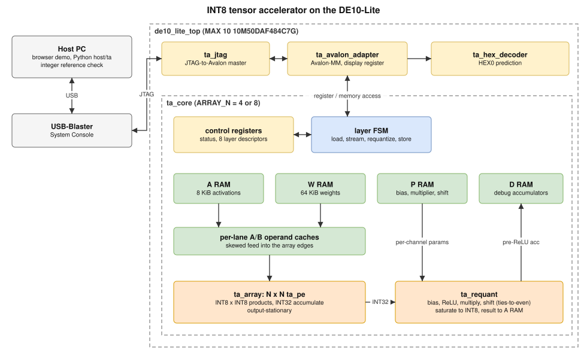
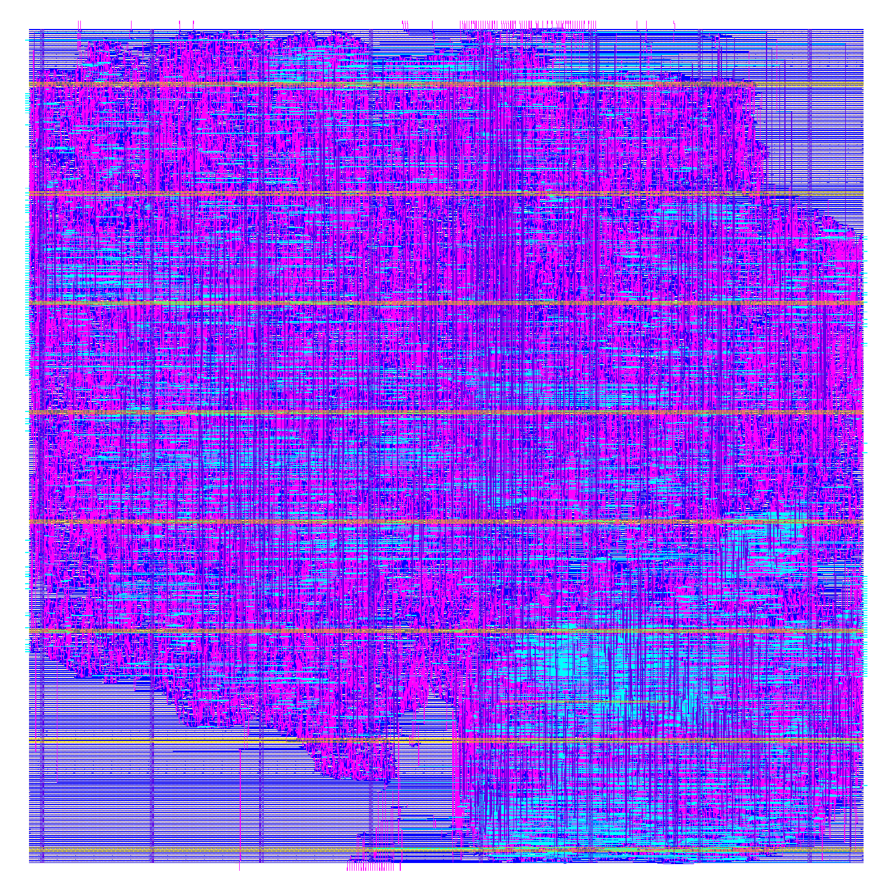

# Tensor Accelerator

[](https://github.com/jchik1102/tensor-accelerator/actions/workflows/ci.yml)

A programmable INT8 inference accelerator for the Terasic DE10-Lite (MAX 10 `10M50DAF484C7G`). An N x N output-stationary systolic array (8x8 in the selected board image, 4x4 also supported) multiplies INT8 activations and weights, accumulates in INT32, and a requantizer applies bias, ReLU, a fixed-point multiplier and a ties-to-even shift before saturating back to INT8. Up to eight layer descriptors run a `784 -> 64 -> 32 -> 10` MNIST network from banked on-chip memories, loaded at runtime over JTAG. A browser demo sends a drawn digit through the board, and the host checks every intermediate layer against an exact integer reference before HEX0 shows the prediction. The RTL is verified in XSim with a UVM 1.2 testbench, assertions, functional coverage and deliberate mutations. A single processing element and the compute datapath (the 8x8 array and the requantizer, without the FPGA memories) have also been through open-PDK synthesis and place-and-route with OpenLane 2 on sky130; nothing has been fabricated.



The diagram is an SVG with the draw.io model embedded; open `docs/block_diagram.svg` in draw.io to edit it.

**Demo video:** _placeholder — link to be added._

## Requirements

- Windows, PowerShell 7, and WSL Ubuntu with `make`. The Makefile uses `pwsh.exe` from `PATH`, or set `PWSH=/path/to/pwsh.exe`.
- Project: `C:\projects\tensor-accelerator`, visible in WSL as `/mnt/c/projects/tensor-accelerator`.
- Dedicated WSL Python 3.12 environment: `/home/jonat/.venvs/tensor-accelerator`. Package versions are in `requirements-lock.txt`.
- Quartus Prime Lite 24.1std, MAX 10 support, System Console, and USB-Blaster drivers at `C:\intelFPGA_lite\24.1std`.
- Vivado 2025.2 at `C:\AMDDesignTools\2025.2\Vivado`, for RTL simulation (XSim, with its bundled UVM 1.2) and, with Artix-7 device support, for `make vivado`.
- For `make questa` only: Questa Intel Starter FPGA Edition 2024.3 (from the Quartus 24.1std download) at `C:\intelFPGA_lite\24.1std\questa_fse` with its free licence, and a python.org Python 3.13 on Windows with cocotb 2.1.0 and pytest in `%USERPROFILE%\.venvs\cocotb-win` (Questa cannot load the Microsoft Store Python).
- For the board demo: a powered DE10-Lite connected through its USB-Blaster programming port.

On a fresh WSL installation:

```bash
python3.12 -m venv ~/.venvs/tensor-accelerator
~/.venvs/tensor-accelerator/bin/python -m pip install \
  --extra-index-url https://download.pytorch.org/whl/cpu \
  -r /mnt/c/projects/tensor-accelerator/requirements-lock.txt
```

The wrappers use the local tool paths above. Adjust them and the native System Console path in `host/ta/board_session.py` if your installation differs. The RTL browser backend uses PowerShell 7 from PATH or the installed Codex runtime; `TA_POWERSHELL` can specify another WSL-visible `pwsh.exe` path.

## Running the checks

| Command (WSL, repository root) | What it runs |
| --- | --- |
| `make models` | Python tests (`pytest tests`) |
| `make test` | `scripts/regress.ps1`: Python tests, the System Console mock, vector and board-plan generation, the C++ model's unit tests, the offline Tcl checks, XSim 4x4 and 8x8 for seeds 1, 42 and 20261008 (with the C++ model as scoreboard), the `pe`/`round`/`bank` mutations, the replay check and the display checks. No board access. Then copies the logs into `results/` |
| `make accuracy` | `host.ta.evaluate_accuracy`: CPU integer evaluation of the previous and current models on the MNIST test set and synthetic variants |
| `make fpga` | `scripts/build-upgrade.ps1 -ArrayN 8 -CoreMHz 75 -Variant repro`; writes to a new variant folder so the qualified `hex-v2` images stay untouched |
| `make results` | copies the logs that back this README from `artifacts/` into `results/` |
| `make vivado` | Vivado out-of-context synthesis, placement and routing of `ta_core` (4x4 and 8x8) for a Xilinx Artix-7 at 75 MHz, reports in `results/vivado/`; see [Vivado](#vivado-implementation-for-a-xilinx-part) |
| `make asic` | OpenLane 2.3.10 (Docker) on the compute tile in [`asic/`](asic/), then copies its reports to `results/asic/d20/`; see [ASIC flow](#asic-flow-openlane-2-sky130) |
| `make cocotb` | cocotb tests of the requantizer and the 8x8 tile (Icarus Verilog), then the same tests on the `pe` and `round` RTL mutations, each of which must fail |
| `make questa` | The benches the free Questa Starter licence can run, in Questa: `quant_tb` and `adapter_tb` (4x4 and 8x8), the `round` mutation, and the cocotb tests with both mutations; see [Questa](#questa) |
| `make cmodel` | CMake build of the C++ model of `ta_core` in [`cmodel/`](cmodel/) and its unit tests (g++ in WSL); see [C++ model](#c-model-of-ta_core) |
| `make asic-pe` | the same flow on one processing element (`asic/pe/config.json`), reports in `results/asic/pe10d/` |
| `make asic-sim` | the tile's RTL and routed gate-level netlist against the Python reference, with Icarus Verilog |
| `make asic-eqy` | EQY equivalence of the RTL and the routed netlists of the PE run and the tile run; see [ASIC flow](#asic-flow-openlane-2-sky130) |
| `make formal` | not available yet |

The individual PowerShell commands still work as before:

```powershell
& .\scripts\run-python.ps1 -m pytest tests -q
& .\scripts\run-sim.ps1 -ArrayN 4 -Seeds 42
& .\scripts\run-sim.ps1 -ArrayN 8 -Seeds 42
& .\scripts\run-sim.ps1 -Mutation pe          # also -Mutation round, and -ArrayN 8 -Mutation bank
& .\scripts\replay-sim.ps1 -ArrayN 4
& .\scripts\run-hex-check.ps1 -ArrayN 8
& .\scripts\run-hex-check.ps1 -ArrayN 4 -InjectDefect
```

Run simulator wrappers and browser RTL jobs sequentially because they share output directories. Rebuild after RTL edits. `tests/check_physical_http.py` deliberately uses the physical backend of an already running server on port 8766. Run it only when intending to exercise the board.

## Continuous integration

[`.github/workflows/ci.yml`](.github/workflows/ci.yml) runs on every push and pull request, on GitHub's Ubuntu runners: the Python tests except `tests/test_fpga_demo.py` (it drives the mock board session through Quartus's Windows `tclsh`), the cocotb tests with their mutation check, and the ASIC tile's RTL simulation against the Python reference with Icarus Verilog from OSS CAD Suite. The XSim regression and the Quartus builds need the Windows vendor tools, and the OpenLane flow takes about 40 minutes in Docker, so `make test`, `make fpga` and `make asic` run locally and their logs are committed under `results/`.

## Results

Every number below comes from a log in [`results/`](results/), produced by `make test`, `make accuracy` and `make fpga`. [`results/PROVENANCE.txt`](results/PROVENANCE.txt) records the commit and date.

| Check | Result | Log |
| --- | --- | --- |
| Full offline regression (`make test`) | 14 of 14 steps pass | [test.log](results/test.log) |
| Python tests | 34 passed | [test.log](results/test.log) |
| Persistent System Console session (installed System Console, mocked bus) | one connection, one model load, two distinct inputs verified, clean close | [summary](results/persistent-console-summary.json), [test.log](results/test.log) |
| Core UVM bench, 4x4 | 21,264 checks per seed for seeds 1, 42 and 20261008; declared coverage 100% | [core-42.log](results/sim-n4/core-42.log), [coverage](results/sim-n4/coverage-42.txt) |
| Core UVM bench, 8x8 | 21,264 checks per seed for seeds 1, 42 and 20261008; declared coverage 100% | [core-42.log](results/sim-n8/core-42.log), [coverage](results/sim-n8/coverage-42.txt) |
| UVM code coverage of `ta_core` (XSim, merged over the three seeds; testbench excluded) | 4x4: statements 405/412 (98.30%), branches 142/149 (95.30%), conditions 189/210 (90.00%). 8x8: 417/424 (98.35%), 158/165 (95.76%), 269/290 (92.76%). Never executed: host reads of the weight and partial-sum RAMs and of the layer register, and two `default` arms for state values that cannot occur. Toggle coverage is not collected (Vivado 2025.2's report tool crashed on it for the riscv-soc core) | [4x4](results/sim-n4/code-coverage.txt), [8x8](results/sim-n8/code-coverage.txt) |
| Requantization bench | 2,070 cases | [quant-clean.log](results/sim-n4/quant-clean.log) |
| cocotb testbenches | 7 of 7 tests pass: requantizer directed edge cases, 4,000 constrained-random operations covering all 15 functional-coverage bins, start-while-busy and mid-operation reset; 8x8 tile end-to-end matrix products with requantization. Both the `pe` and `round` mutations make them fail | [cocotb.log](results/cocotb.log) |
| Avalon adapter and display | 56 checks | [adapter-clean.log](results/sim-n4/adapter-clean.log), [hex-check-n8.log](results/hex-check-n8.log) |
| Replay determinism | seed-42 replay gives an identical result, activity, gap counts and gap digest | [core-replay-42.log](results/sim-n4/core-replay-42.log) |
| Mutations | arithmetic (`pe`), rounding (`round`), operand-bank (`bank`) and display-segment defects all detected. The `pe`, `round` and `bank` defects are also each caught by the C++ model scoreboard alone, with the vector file's own read checks turned off | [mutation-pe.log](results/sim-n4/mutation-pe.log), [mutation-round.log](results/sim-n4/mutation-round.log), [mutation-bank.log](results/sim-n8/mutation-bank.log), scoreboard only: [pe](results/sim-n4/mutation-pe-scoreboard.log), [round](results/sim-n4/mutation-round-scoreboard.log), [bank](results/sim-n8/mutation-bank-scoreboard.log); [test.log](results/test.log) |
| C++ model as the core bench's scoreboard (DPI-C) | every bus response the RTL gave matched the model's prediction, error flag and data: 107,667, 107,662 and 107,667 responses for seeds 1, 42 and 20261008 on the 4x4 array and 105,452, 105,443 and 105,448 on the 8x8, across 8 resets per run; the bench's own results are unchanged (same checks, coverage and gap digests as before the scoreboard) | [core-42.log](results/sim-n4/core-42.log) (`MODEL_SCOREBOARD_PASS`), [8x8](results/sim-n8/core-42.log) |
| C++ model unit tests (CTest) | 4 of 4 pass: 2,070 requantization cases from the Python reference plus 10 worked by hand; directed register-map, error-code, busy, cycle-count, two-layer and mid-job reset tests (4,338 checks); the core bench's vector file replayed on the model with no RTL, for 4x4 and 8x8 (121,182 checks each) | [cmodel.log](results/cmodel.log) |
| Selected model compute cycles | 4x4: 32,045; 8x8: 17,337 | [4x4](results/sim-n4/core-42.log), [8x8](results/sim-n8/core-42.log) |
| MNIST test accuracy, 10,000 images, INT8 | 97.49% (previous model 96.75%) | [accuracy-comparison.json](results/accuracy-comparison.json), [accuracy.log](results/accuracy.log) |
| Selected model before quantization (float) | 97.41% on the 10,000 test images; 97.76% on the 5,000 held-out validation images; INT8 is 0.08 points higher than float | [float-accuracy.json](results/float-accuracy.json), [float-accuracy.log](results/float-accuracy.log) |

Declared coverage bins reaching 100% is not exhaustive coverage.

On deterministic synthetic variants of 2,000 MNIST test images, previous/current INT8 accuracy was 16.80%/95.90% for smaller shifted digits, 15.85%/96.65% for larger shifted digits, 79.65%/92.05% for thicker strokes, 95.20%/96.20% for thinner strokes, and 91.65%/94.75% for 12-degree rotation ([accuracy.log](results/accuracy.log)). These compare whole preprocessing/model pipelines, not independent effects or real handwriting accuracy.

**FPGA builds at 75 MHz** (`make fpga` and `make fpga ARRAY_N=4`, Quartus Prime Lite 24.1std, 10M50DAF484C7G; logs [fpga-n8.log](results/fpga-n8.log), [fpga-n4.log](results/fpga-n4.log)). The 8x8 image is the selected one.

| Measurement | 4x4 array | 8x8 array | Reports |
| --- | --- | --- | --- |
| Logic elements | 8,901 / 49,760 (18%) | 14,067 / 49,760 (28%) | [4x4](results/fpga-n4/de10_lite.fit.summary), [8x8](results/fpga-n8/de10_lite.fit.summary) |
| Registers | 4,453 | 7,412 | same |
| Memory bits | 885,248 / 1,677,312 (53%) | 950,784 / 1,677,312 (57%) | same |
| 9-bit multipliers | 29 / 288 | 77 / 288 | same |
| Worst setup slack, 75 MHz core clock | +0.728 ns (slow 85 °C) | +0.409 ns (slow 85 °C) | [4x4](results/fpga-n4/de10_lite.sta.summary), [8x8](results/fpga-n8/de10_lite.sta.summary) |
| Worst hold slack, core clock | +0.134 ns (fast 0 °C) | +0.131 ns (fast 0 °C) | same |

### Vivado implementation for a Xilinx part

`make vivado` builds `ta_core` (the array, operand and vector RAMs and requantizer, without the board's I/O and Avalon wrapper) with Vivado 2025.2 for an Artix-7 xc7a100tcsg324-1, out of context, at the board's 75 MHz (13.333 ns): synthesis, placement, physical optimization and routing ([`scripts/vivado-impl.tcl`](scripts/vivado-impl.tcl)). It checks that the RTL is not tied to Quartus and meets timing on a second vendor's tools. Nothing was run on Xilinx hardware. Fmax is 1000 / (period − worst slack).

| Measurement | 4x4 array | 8x8 array | Reports |
| --- | --- | --- | --- |
| Slice LUTs | 5,227 / 63,400 (8.2%) | 10,994 / 63,400 (17.3%) | [4x4](results/vivado/n4/utilization.txt), [8x8](results/vivado/n8/utilization.txt) |
| Slice registers | 3,948 / 126,800 | 7,052 / 126,800 | same |
| Block RAM tiles | 30 / 135 | 44 / 135 | same |
| DSP48E1 | 6 / 240 | 6 / 240 | same |
| Worst setup slack, 75 MHz | +0.312 ns (76.80 MHz) | +0.181 ns (76.03 MHz) | [4x4](results/vivado/n4/timing_summary.txt), [8x8](results/vivado/n8/timing_summary.txt) |
| Worst hold slack | +0.131 ns | +0.147 ns | same |
| Unrouted nets | 0 | 0 | [4x4](results/vivado/n4/result.txt), [8x8](results/vivado/n8/result.txt) |

The per-module report ([4x4](results/vivado/n4/utilization_hierarchy.txt), [8x8](results/vivado/n8/utilization_hierarchy.txt)) shows that Vivado built the array's products from LUTs, not DSP48s: the 8x8 array alone takes 6,400 LUTs (58% of the total) and no DSPs, and the six DSP48s are in the requantizer (4) and the top level (2). Quartus does use hard multipliers for them: its 9-bit multiplier count grows by 48 from the 4x4 to the 8x8 build, one per added PE (table above).

### C++ model of ta_core

[`cmodel/`](cmodel/) is a C++17 model of `ta_core` at the bus-transaction level ([`ta_model.hpp`](cmodel/include/ta_model.hpp), [`ta_model.cpp`](cmodel/src/ta_model.cpp)). A `ta::Core` object takes the same 32-bit register and memory accesses as the RTL and returns the same error flag and read data. Descriptors and layer checks are a `Descriptor` class, and the requantizer is a free function with the RTL's round-half-to-even and saturation. The model is bit-exact for the arithmetic and cycle-exact for job length: it computes each job's length from `ta_core`'s state sequence, so it knows on which clock edge the core stops being busy, what the CYCLES and LAYER registers read on any edge, and which output stores had already happened when a reset cuts a job short. It is a second implementation written from the RTL and the register map, separate from the Python model that writes the vector file's expected values.

It is checked three ways. CMake unit tests (`make cmodel`) run the requantizer on the 2,070 Python-reference cases, run directed tests of the register map, error codes, busy rejection, cycle count, a two-layer job and a mid-job soft reset, and replay the core bench's whole vector file on the model with no RTL. In XSim, the same sources are compiled into the DPI-C library (`xsc`, in [`scripts/run-sim.ps1`](scripts/run-sim.ps1)). A scoreboard class in [`tb/core_tb.sv`](tb/core_tb.sv) (it extends `uvm_scoreboard`, but the bench does not use the UVM phases) passes every accepted bus access and every reset to the model, with the clock edge it happened on, and compares every RTL response with the model's. With `+SCOREBOARD_ONLY` the vector file's own read checks are off, and the regression uses that to show the scoreboard alone catches each RTL mutation. Results are in the table above. No RTL bug was found: the scoreboard agreed with the RTL on its first run.

### Questa

`make questa` ([`scripts/run-questa.ps1`](scripts/run-questa.ps1)) runs the benches in a second simulator, Questa Intel Starter FPGA Edition 2024.3. The UVM bench `core_tb` does not run there: the free licence has no SystemVerilog verification feature, so Questa refuses `randomize()` and covergroups (error vsim-1), which `core_tb` uses. Everything else runs unchanged:

| Check | Result | Log |
| --- | --- | --- |
| `quant_tb`, 4x4 and 8x8 builds | 2,070 cases pass in each | [quant_tb_n4.log](results/questa/quant_tb_n4.log), [quant_tb_n8.log](results/questa/quant_tb_n8.log) |
| `adapter_tb`, 4x4 and 8x8 builds | 56 checks pass in each | [adapter_tb_n4.log](results/questa/adapter_tb_n4.log), [adapter_tb_n8.log](results/questa/adapter_tb_n8.log) |
| `quant_tb` with the `round` mutation | fails on the first mismatch | [quant_tb_mutate_round.log](results/questa/quant_tb_mutate_round.log) |
| cocotb tests through Questa's VPI (`COCOTB_SIM=questa`) | 7 of 7 pass (requantizer 4, tile 3), with the same counts and end times as under Icarus | [cocotb.log](results/questa/cocotb.log) |
| The same cocotb tests on the `pe` and `round` mutations | each fails | [summary.txt](results/questa/summary.txt) |

The licence allows one Questa session at a time on the machine.

### Not yet backed by a log

These were measured before the logs were deleted, and are left out until a new run produces them:

- Physical board runs: cold and warm inference latency, the scratch-transfer check, and the predictions shown on HEX0.

Retained model JSON SHA-256: `8e25d12fbab0bda949b0243287e833a7c3e9b948e2e712da6115933dcb11eb80`.

## ASIC flow (OpenLane 2, sky130)

This is open-PDK synthesis and place-and-route of parts of the design: nothing has been fabricated, and neither block is wrapped for a shuttle or connected to pads.

**One processing element first.** `rtl/ta_pe.sv` on its own, at a 10 ns clock ([config](asic/pe/config.json)). With OpenLane's default area-oriented synthesis it missed timing by 0.257 ns on 3 endpoints; delay-oriented synthesis (`SYNTH_STRATEGY "DELAY 1"`) closed it ([runs.txt](results/asic/runs.txt)).

| Result (run `pe10d`, 10 ns clock) | Value | Report |
| --- | --- | --- |
| Die | 160 x 171 µm; 1,472 cells (65 sequential), 10,256 µm² cell area | [metrics.json](results/asic/pe10d/metrics.json) |
| Setup slack, 100 MHz | +4.50 ns typical; +1.24 ns worst (slow corner) | [sta-signoff-summary.rpt](results/asic/pe10d/sta-signoff-summary.rpt) |
| Hold slack | +0.108 ns worst | [sta-signoff-summary.rpt](results/asic/pe10d/sta-signoff-summary.rpt) |
| DRC (Magic and KLayout), LVS, antenna | 0, 0, 0, 0 | [metrics.json](results/asic/pe10d/metrics.json), [lvs](results/asic/pe10d/lvs.netgen.rpt) |
| Power (estimate, default activity, tt) | 1.36 mW | [metrics.json](results/asic/pe10d/metrics.json) |
| Open items | 3 max-slew violations in the slow corner | [checks](results/asic/pe10d/sta-max_ss_100C_1v60-checks.rpt) |

**Then the array: what goes through the flow.** [`asic/ta_asic_tile.sv`](asic/ta_asic_tile.sv) is the compute datapath of `ta_core`: the unchanged `ta_array` (8x8 PEs) and `ta_requant`, plus `ta_core`'s output stage (`acc = sums[lane] + bias`, then requantize), with every port registered once. The FPGA design keeps about 100 KiB of activations, weights, parameters and caches in M9K RAM; sky130 has no equivalent without SRAM macros and a rewrite of `ta_core`'s memory interface, so the memories and the controller are not part of the tile. Their data enters and leaves through the tile's ports instead.

**Flow.** OpenLane 2.3.10 in Docker with the open_pdks revision it pins (`0fe599b`), sky130A and the `sky130_fd_sc_hd` cells. `ta_array` uses unpacked-array ports, which Yosys's own SystemVerilog frontend rejects, so the flow reads the RTL with Synlig (`USE_SYNLIG`); no RTL was changed. The settings are in [`asic/config.json`](asic/config.json).

| Result (run `d20`, 20 ns clock) | Value | Report |
| --- | --- | --- |
| Die | 1,179 x 1,190 µm; 52.9% core utilization | [metrics.json](results/asic/d20/metrics.json) |
| Cells | 125,774, of which 4,487 sequential and 38,697 antenna diodes; 720,432 µm² cell area | [metrics.json](results/asic/d20/metrics.json), [synthesis](results/asic/d20/synthesis-stat.rpt) |
| Setup slack, 50 MHz | +10.28 ns typical (tt, 25 °C, 1.80 V); +1.49 ns worst (ss, 100 °C, 1.60 V, max parasitics) | [sta-signoff-summary.rpt](results/asic/d20/sta-signoff-summary.rpt), [worst ss path](results/asic/d20/sta-max_ss_100C_1v60-worst-setup.rpt) |
| Hold slack | +0.035 ns worst | [sta-signoff-summary.rpt](results/asic/d20/sta-signoff-summary.rpt) |
| DRC (Magic and KLayout), LVS | 0 errors, 0 errors, 0 errors | [magic](results/asic/d20/drc_violations.magic.rpt), [klayout](results/asic/d20/drc_violations.klayout.json), [lvs](results/asic/d20/lvs.netgen.rpt) |
| Power (estimate, default activity, tt) | 32.4 mW | [metrics.json](results/asic/d20/metrics.json) |
| Gate-level simulation of the routed netlist | 24 matrix products, 1,536 output lanes, all match the Python reference (same vectors as the RTL run) | [sim-gl.log](results/asic/d20/sim-gl.log), [sim-rtl.log](results/asic/d20/sim-rtl.log) |
| Equivalence of RTL and routed netlist (EQY, `make asic-eqy`) | one PE: proved (5 of 5 partitions). Tile: 1,184 of 1,185 partitions proved; the requantizer's 64-bit product register (a 32 x 31-bit multiply) was not proved within 30 minutes and no counterexample was found. See below | [summary.txt](results/asic/eqy/summary.txt), [tile.log](results/asic/eqy/tile.log), [pe.log](results/asic/eqy/pe.log) |



**Open signoff items.** The flow completes, but these remain and would have to be fixed before the block could be used anywhere: 2 nets with antenna violations; 639 max-slew and 79 max-cap violations, the slew ones almost all in the slow corner (3 slew and 63 cap at typical); and 3,698 pins over the fanout limit of 10, mostly because the inserted diodes add load pins (194 in the run without heuristic diodes); the worst slew is on the `clk` input net ([slow-corner checks](results/asic/d20/sta-max_ss_100C_1v60-checks.rpt)). Four configurations of the tile were run; [runs.txt](results/asic/runs.txt) compares them. The first (default area-oriented synthesis) missed timing in the slow corner by 2.6 ns on the requantizer's single-cycle 64-bit negate. Delay-oriented synthesis fixed that. Turning the heuristic diode insertion off removed most diodes and slew violations but left 60 antenna nets, and a middle setting left 17. The selected run has the fewest antenna violations.

**Equivalence of the RTL and the routed netlists.** [`asic/eqy/run.sh`](asic/eqy/run.sh) (`make asic-eqy`) compares the RTL with the final netlists of the PE run and the tile run using EQY from OSS CAD Suite: the netlist's cells are read with their functions from the sky130_fd_sc_hd liberty file, the fill, tap and decap cells (no logic) get empty modules ([`netlist_stubs.py`](asic/eqy/netlist_stubs.py), which refuses to stub any cell with connections), and every register bit is matched by name and each partition between matched points proved by induction with SymbiYosys. For the PE ([`pe.eqy`](asic/eqy/pe.eqy)) every partition is proved. For the tile ([`tile.eqy`](asic/eqy/tile.eqy)) three things had to be accounted for, and each is an assumption of the check rather than something it proves:

- **Frontend.** The flow read the RTL with Synlig. Read with Yosys's own frontends, the flattened wire arrays between the PEs are numbered differently from the netlist's, so the gold is the RTL as Synlig elaborates it, in the OpenLane image ([`gold_synlig.ys`](asic/eqy/gold_synlig.ys)).
- **State encoding.** Synthesis re-encoded the requantizer's 3-bit `phase` register as 5-bit one-hot. The gold gets the same Yosys FSM pass, in the same Yosys version, and produces the same encoding as the flow's log ([flow](results/asic/eqy/tile_flow_fsm.txt), [gold](results/asic/eqy/tile_gold_fsm.txt)); the recoding itself is trusted, not proved.
- **Merged registers.** Every PE's `product_valid` register holds the same value, and synthesis kept only PE (0,0)'s. The 64 RTL registers are matched to that one.

With those, 1,184 of the 1,185 partitions are proved. The one left is `quant_unit.product`, `value * multiplier`: SAT-based equivalence of a 32 x 31-bit multiplier against its gate-level form did not finish in 30 minutes, and found no difference in that time ([log](results/asic/eqy/tile_product_timeout.log)). That path is covered only by simulation: the gate-level run above, 1,536 lanes against the Python reference. The run was stopped after the solver did not exit at its timeout, so its log has no final summary line.

**How the tile is tested.** [`asic/tile_vectors.py`](asic/tile_vectors.py) builds skewed INT8 matrix products and expected results from `host.ta.numeric.requantize`, including exact rounding ties; [`asic/ta_asic_tile_tb.sv`](asic/ta_asic_tile_tb.sv) checks the accumulator and the requantized result of every lane. On the RTL it detects both of the repository's datapath mutations (`TA_MUTATE_PE` and `TA_MUTATE_ROUND`).

## Run with the DE10-Lite

### 1. Load the supplied image

Stop any previous drawing server with Ctrl+C and close other System Console sessions. In PowerShell 7:

```powershell
Set-Location C:\projects\tensor-accelerator
& 'C:\intelFPGA_lite\24.1std\quartus\bin64\jtagconfig.exe'
& 'C:\intelFPGA_lite\24.1std\quartus\bin64\quartus_pgm.exe' --list
Get-FileHash .\artifacts\board-n8-75-hex-v2\output_files\de10_lite.sof -Algorithm SHA256
```

Confirm the connected device is the DE10-Lite/MAX 10. The supplied 8x8 image SHA-256 is:

```text
3F09CFC5C36673CBBCA56968BAAB58A11D510EEC37F9AEF13C11F586EB6C5437
```

In Quartus Programmer, select the discovered USB-Blaster cable, choose JTAG mode, add `artifacts/board-n8-75-hex-v2/output_files/de10_lite.sof`, select Program/Configure, and click Start. This is volatile configuration: power loss requires loading the SOF again. Do not select a core-only synthesis image or the tool-diagnostic counter image.

For the previously tested `USB-Blaster [USB-0]` cable, the equivalent command is:

```powershell
& 'C:\intelFPGA_lite\24.1std\quartus\bin64\quartus_pgm.exe' -c 'USB-Blaster [USB-0]' -m JTAG -o 'p;artifacts/board-n8-75-hex-v2/output_files/de10_lite.sof@1'
```

Use the cable and device position actually reported by discovery if they differ.

### 2. Discover and check the master service

Open System Console from Quartus's Tools menu:

```tcl
get_service_paths master
```

Copy the exact path for the loaded accelerator, then run:

```tcl
set env(TA_MASTER_PATH) {paste the discovered master path here}
set env(TA_BOARD_IMAGE_CONFIRMED) TA01
source C:/projects/tensor-accelerator/fpga/board/qualify-runtime.tcl
```

The check verifies identity and idle status, tests four scratch patterns, and restores scratch contents. For the display-register check, run `source C:/projects/tensor-accelerator/fpga/board/qualify-hex.tcl` in the same console. This also performs software reset, so run it before starting the demo. Close System Console afterward so the drawing server can own the connection.

### 3. Start the drawing website

In PowerShell 7, substitute the exact discovered master path:

```powershell
& .\scripts\run-python.ps1 -m host.ta.demo --port 8766 --fpga-clock-mhz 75 --fpga-master '/devices/10M50DA(.|ES)|10M50DC@1#USB-0/(link)/JTAG/(110:132 v1 #0)/phy_0/master'
```

Open [localhost:8766](http://localhost:8766), select **Physical FPGA**, click **Example**, then **Run inference**. Next, clear the canvas and draw a digit. The normalized preview shows the actual 28x28 input. For software-only drawing, omit the FPGA options.

The first inference starts System Console and loads the model, which takes a while. Later requests reuse the connection and weights. Successful FPGA results report all three layers matching and the display register being updated. HEX0 shows the prediction; HEX1 through HEX5 are blank. A dash is the reset/cleared state. The host performs final argmax and writes HEX0 only after the independent comparison passes.

Keep the board powered and avoid accessing it from another console while the server owns it. Stop the server with Ctrl+C. After reset, disconnect, timeout, or reprogramming, stop the server, rediscover and check the endpoint, then restart to reload the model. There is no automatic retry of an uncertain inference. A disconnected display can retain its last digit.

`--fpga-clock-mhz` changes cycle-to-time reporting only; the SOF determines the actual clock. Older images without the HEX1 capability are rejected.

## Rebuilding and retraining

Rebuild exact-device board images:

```powershell
& .\scripts\build-upgrade.ps1 -ArrayN 8 -CoreMHz 75 -Variant hex-v2
& .\scripts\build-upgrade.ps1 -ArrayN 4 -CoreMHz 75 -Variant hex-v2
```

The upgrade runner generates missing JTAG IP automatically, compiles the board, checks timing summaries, and rejects source changes during a build. Rebuilding replaces that variant's SOF and produces a new hash, so use a new `-Variant` name to keep the qualified images. `build-board.ps1` builds the original 4x4/50 MHz configuration. `run-synthesis.ps1 -ArrayN 4` or `8` performs core-only feasibility builds.

Retrain/export to the candidate directory without replacing the selected model:

```powershell
& .\scripts\run-python.ps1 -m host.ta.train --epochs 35 --augment --output artifacts/model-candidate
& .\scripts\run-python.ps1 -m host.ta.evaluate_accuracy
```

After validating a candidate, copy its `model.json`, `model.onnx`, `weights.pt`, and `samples.npz` into `artifacts/model`, regenerate vectors, rerun tests and RTL checks, and restart the demo. Training uses 55,000 training images, 5,000 validation images, and 1,024 training images for calibration. Test images are excluded from training and checkpoint selection. Seed: 20261008.

## Problems encountered during development

1. **Requantization missed timing.** The original board build had negative setup slack through the requantizer. Registering magnitude, rounding, and clamp stages repaired that path. Later banked operand delivery and PE pipelining supported the 75 MHz builds.
2. **Drawing position and scale hurt recognition.** Resizing the whole canvas left small or shifted digits unlike training inputs. Shared crop/scale/centroid normalization and augmented retraining raised accuracy on shifted test variants (see Results). The browser now previews the normalized input.
3. **Repeated setup dominated latency.** Starting System Console and loading weights for every click made every request slow. A persistent session, one model load, and block transfers removed that cost from warm requests.
4. **Native tool launching and exit codes were misleading.** AMD's batch loader split a named plusarg at `=`, so the wrapper uses an options file. Some fatal XSim mismatches still returned exit code zero, so runners inspect explicit pass/mismatch markers. System Console needs stdin held open to avoid early exit.
5. **A source file changed during a build.** Editing `session.tcl` during the initial display-version compile invalidated its manifest. The runner rejected that result; a rerun with unchanged sources produced the accepted image.
6. **XSim would not start with the C++ model linked.** Once `core_tb` linked the DPI library, the simulation kernel exited at start-up with status 0xC0000139 (a DLL entry point not found) whenever `XILINX_VIVADO` was set in the environment, which `run-sim.ps1` had always done. With the variable unset the same snapshot runs; the script now unsets it after compiling and before simulating.

Design decisions and the reasoning behind them are in [DESIGN.md](DESIGN.md).

## Implementation reference

Arithmetic uses signed INT8 operands, INT16 products, and INT32 accumulation. Bias is applied once, optional ReLU precedes requantization, multiplication uses INT64, division by a power of two rounds ties to even, and the result saturates to INT8. Bias bounds prevent INT32 overflow. Multipliers are 1..2147483647 and shifts are 0..62. Host argmax chooses the first maximum.

The core supports M=1..32, K=1..1024, N=1..128, eight layer descriptors, 8,192 activation bytes, 65,536 weight bytes, 1,024 parameter channels, and 4,096 debug accumulators. Activations are row-major; weights are output-major `[N,K]`. Descriptor words are M, K, N, source, destination, weight offset, parameter offset, flags; flag bit 0 enables ReLU. Source/destination cannot overlap. ONNX support is a fixed float32 opset-18 Gemm/Relu chain with constant weights/biases, `alpha=beta=1`, `transA=0`, and `transB=1`.

Input is white ink on black. `ink20-com-v1` crops values above 16, fits ink into a 20x20 box, and centers its intensity centroid in 28x28. Pixels are quantized with nearest-even rounding of `pixel*127/255`. Empty inputs fail.

TA01 uses aligned 32-bit accesses with one byte per bus word for byte memories:

| Address | Meaning |
| --- | --- |
| `0x0000` | ID `0x54413031` |
| `0x0004` | Status: bit 0 busy, bit 1 done, bit 2 error |
| `0x0008` | Commands: 1 start, 2 clear done/error, 4 software reset |
| `0x000C` | Layer count |
| `0x0010` | Error: 1 access, 2 busy, 3 descriptor, 4 parameter |
| `0x0014`, `0x0018` | Compute cycles and current descriptor |
| `0x0020`, `0x0024` | Display digit/dash and HEX1 capability `0x48455831` |
| `0x0100..0x01FC` | Eight descriptors of eight words |
| `0x1000..0x3FFC` | Bias, multiplier, shift channel parameters |
| `0x10000..0x17FFC` | Activation bytes |
| `0x20000..0x5FFFC` | Weight bytes |
| `0x60000..0x63FFC` | Read-only pre-ReLU accumulators |

Reset aborts work and clears control/descriptors but does not erase RAM; reload all required data. Configuration writes while busy are rejected. Display values 0..9 show digits; other values show a dash. HEX outputs are active low, bit 0 is segment a, and bit 7 is the decimal point, held off. Pin assignments follow the [Terasic DE10-Lite manual](https://www.mouser.com/datasheet/2/598/DE10_Lite_User_Manual-1100361.pdf), tables 3-2, 3-3, and 3-6.

## File layout

| Location | Purpose |
| --- | --- |
| `rtl/` | Reusable PE, array, banked RAM, requantizer, and programmable core |
| `fpga/board/` | DE10-Lite integration, Avalon/display interface, JTAG generation, and physical checks |
| `fpga/quartus/` | Core build and timing constraints/report scripts |
| `host/ta/` | Reference arithmetic, model tools, preprocessing, host transport, and demo server |
| `demo/index.html` | Drawing interface |
| `scripts/` | PowerShell build, simulation, and execution runners; `regress.ps1` runs the offline regression |
| `tb/`, `tests/` | RTL testbenches (`tb/cocotb/`: cocotb tests), Python tests, and Tcl mock/physical checks |
| `cmodel/` | C++ model of `ta_core` (the core bench's DPI-C scoreboard) and its CMake unit tests |
| `asic/` | ASIC compute tile and single-PE configs, its testbench and vector generator, OpenLane config, and collection/render scripts |
| `results/` | Committed logs behind the numbers in this README |
| `docs/` | Block diagram |
| `artifacts/model/` | The trained model the hex images, accuracy results and tests use |
| `artifacts/` (other folders, git-ignored) | Retained SOFs, vectors, simulator output |
| `data/MNIST/` (git-ignored) | Dataset for training, evaluation, and physical sample tests |
